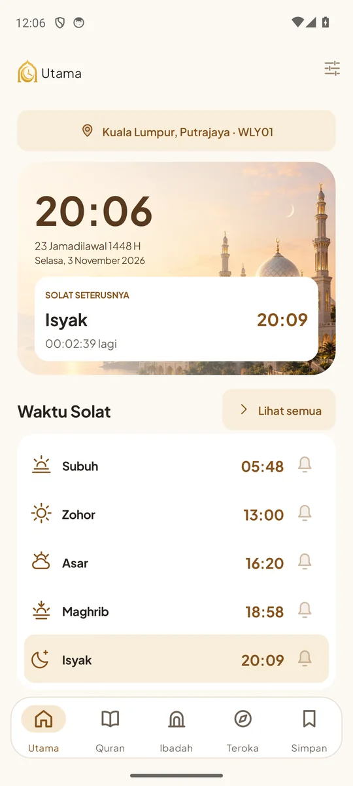
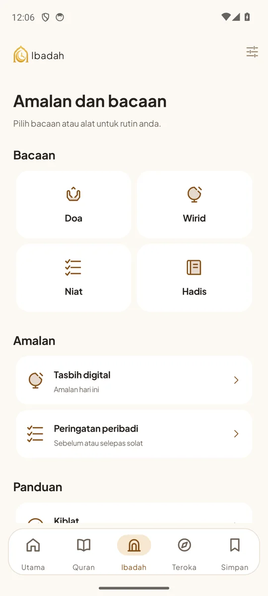
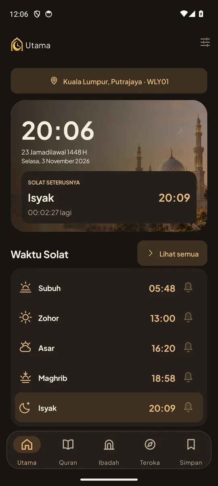
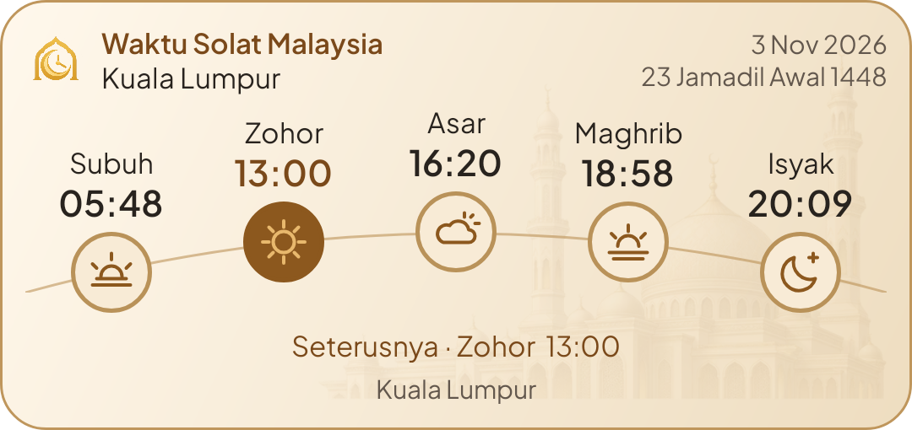

<p align="center"></p>

<h1 align="center">Waktu Solat Malaysia</h1>

<p align="center"><strong>Waktu solat, bacaan dan amalan — dekat dengan kehidupan harian.</strong><br />
A community Android app for prayer times and daily worship in Malaysia.</p>

<p align="center">
  <a href="https://github.com/LeonixZx/waktu-solat-malaysia/actions/workflows/build.yml"></a>
  <a href="LICENSE"></a>
  
  
</p>


<p align="center">
  <a href="https://github.com/LeonixZx/waktu-solat-malaysia/releases/download/v3.3.4/Waktu-Solat-Malaysia-v3.3.4-debug.apk"><strong>Download Android APK · v3.3.4</strong></a>
  &nbsp; · &nbsp; <a href="docs/INSTALL.md">Install guide</a>
  &nbsp; · &nbsp; <a href="CLONE_AND_BUILD.md">Build your own APK</a>
  &nbsp; · &nbsp; <a href="CONTRIBUTING.md">Contribute</a>
</p>

## Try the app

Download the **debug APK** above on your Android phone or tablet, open it, then allow installation from that browser/file manager when Android asks. Choose your state and official prayer zone on first launch. There is no account to create.

This is a **development pre-release**, distributed directly from GitHub. Android is **3.3.4**; the companion web app is **3.1.0**. An unsigned release APK is also available for developers; it must be signed before installation. See [installation, upgrades and notification setup](docs/INSTALL.md).

## Made for everyday use

| Feature | What you can do |
| --- | --- |
| **Prayer times** | Choose from 60 JAKIM zones, see the next prayer and browse the full daily timetable. Validated schedules are cached for offline use. |
| **Azan & reminders** | Choose Off, Notification or Azan per prayer; create personal reminders before or after a prayer time. |
| **Home-screen widgets** | Pick next prayer, a wide strip, today's prayers or Daily Plus. Choose Classic/Timeline and Ivory/Noir; supported widgets show named Hijri and Gregorian dates. |
| **Quran & readings** | Read Arabic with labelled published translations, save your place and download Quran text. Recitation streams on demand. Browse doa, wirid, niat and hadith. |
| **Daily worship** | Use tasbih, prayer tracking, the Islamic calendar and Kiblat bearing/compass guidance. |
| **Explore & save** | Discover attributed institutional articles/videos, bookmark content and export/import your local records. |

Malay and English controls, light/dark appearances, and adaptive phone/tablet layouts are included. The companion PWA provides reading, cached timetables and local records in a modern browser; scheduled background azan and Android widgets are Android features.

## A look inside

<table>
  <tr>
    <td align="center"><br /><strong>Your day at a glance</strong></td>
    <td align="center"><br /><strong>A place for daily worship</strong></td>
    <td align="center"><br /><strong>Comfortable after dark</strong></td>
  </tr>
</table>

*Fresh Android 14 emulator captures of v3.3.4, checked for foreground focus and ANR/crash dialogs at capture time. Public sample zone; dates/times illustrate the session. [Capture verification](docs/SCREENSHOT_VERIFICATION.md). The mosque banner is original AI-generated decorative artwork.*

### Prayer times on your home screen

<picture>
  <source media="(prefers-color-scheme: dark)" srcset="design/widgets-v333/day-dark-native.png" />
  
</picture>

*Native renderer preview with labelled sample data. Your launcher determines the space available to a placed widget.*

## Build your own APK

Install **JDK 21**, Android SDK **Platform 34**, **Build Tools 34.0.0**, and **platform-tools**. Set `JAVA_HOME` and `ANDROID_HOME`, or configure your SDK through Android Studio. The Gradle wrapper is included; no system Gradle or private API key is required.

```powershell
git clone https://github.com/LeonixZx/waktu-solat-malaysia.git
cd waktu-solat-malaysia
.\gradlew.bat :app:assembleDebug
```

On macOS/Linux, use `./gradlew :app:assembleDebug` for the last command.

Your installable APK is **`app/build/outputs/apk/debug/app-debug.apk`**. For Android Studio, open the cloned root folder and choose JDK 21 as the Gradle JDK. [Full setup, testing, signing and troubleshooting →](CLONE_AND_BUILD.md)

**Prefer building in the cloud?** Fork this repo, open **Actions → Build and verify → Run workflow**, and download the **android-debug** artifact when the run passes. GitHub sign-in is required for Actions artifacts. Each build includes a checksum. These use a temporary development signing key, so they may not update an APK signed on another computer.

## Run the web app locally

With **Node.js 24** installed:

```sh
cd web
npm ci
npm run build
npm run worker:dev -- --port 8787
```

Open **http://127.0.0.1:8787** and use your browser's Install app option where supported. There is no hosted public web deployment yet. Cloudflare account/domain setup is separate. [Web development details →](CLONE_AND_BUILD.md#web-app)

## Explore the source

| Path | Contents |
| --- | --- |
| `app/src/main/` | Native Android Java, XML layouts and app assets |
| `app/src/test/`, `app/src/androidTest/` | JVM and native Android tests |
| `web/` | React/TypeScript PWA and allowlisted API adapter |
| `shared/` | Catalog, design tokens, contracts and public test fixtures |
| `design/` | Original branding/art sources, prompts and current widget previews |
| `tools/`, `testing/` | Privacy checks, environment checks and opt-in QA tooling |
| `docs/` | Installation, content rights and historical design/verification notes |

The decoded reference app, private keys, phone backups, SDK installations and generated build files are **not build dependencies**. APKs and recovery downloads live in [Releases](https://github.com/LeonixZx/waktu-solat-malaysia/releases), rather than in Git source.

## Community, privacy & attribution

Anyone can clone, study and improve the project-authored code under [GPL v3](LICENSE). Contributions in Bahasa Melayu or English are welcome; please read [CONTRIBUTING.md](CONTRIBUTING.md). Report ordinary bugs through [Issues](https://github.com/LeonixZx/waktu-solat-malaysia/issues), and use the private route in [SECURITY.md](SECURITY.md) for security problems.

Personal bookmarks, tracking and reminders stay in local app storage unless you export them. External prayer/content/media providers receive requests when their features are used; see [PRIVACY.md](PRIVACY.md). Source backup does not back up your phone data or signing keys.

This is an independent community project, with no claimed affiliation to JAKIM or the reference publisher. Third-party materials retain their own terms. **Some inherited content/recording redistribution permissions remain unverified**; see the [content-rights register](docs/CONTENT_RIGHTS.md), [NOTICE](NOTICE.md) and [asset provenance](ASSET_PROVENANCE.md) before redistributing a build. Compass results depend on location, sensors and magnetic interference; no physical direction certification is claimed.

**Help make it useful for everyone:** improve accessibility, verify content references, test a launcher, translate interface labels or contribute a focused fix.
